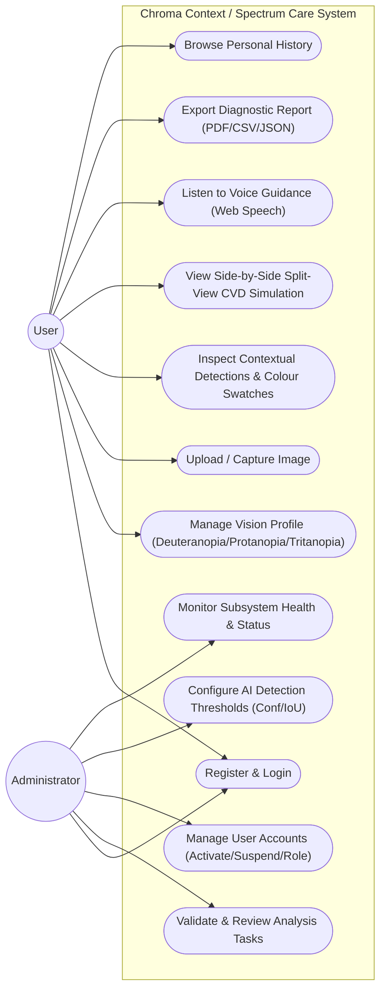
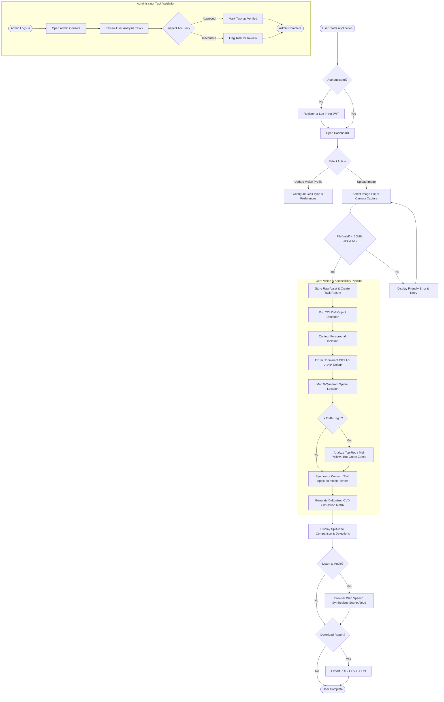
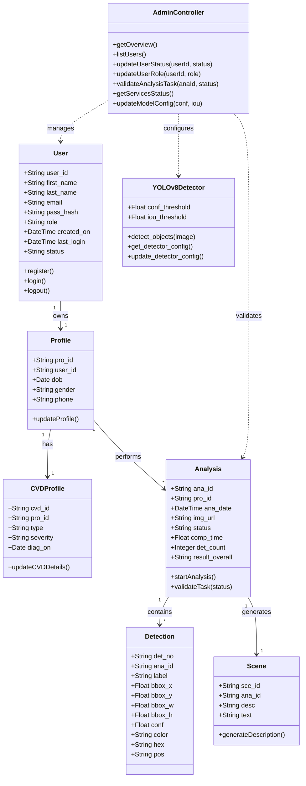
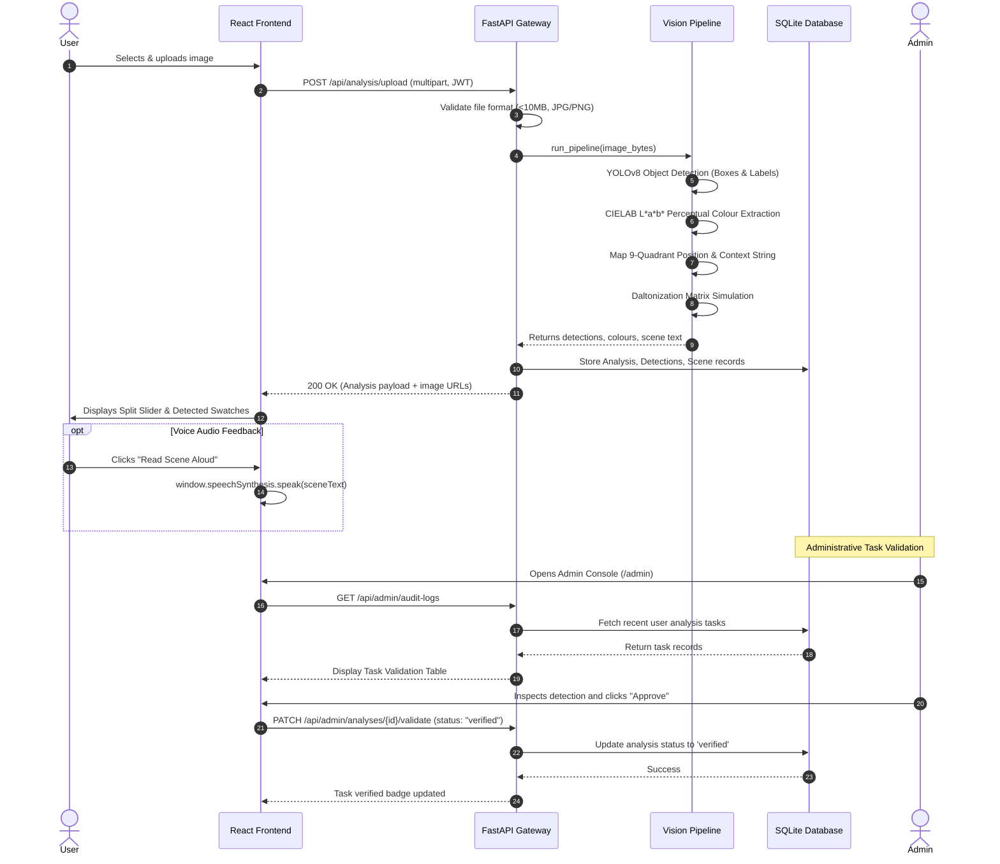
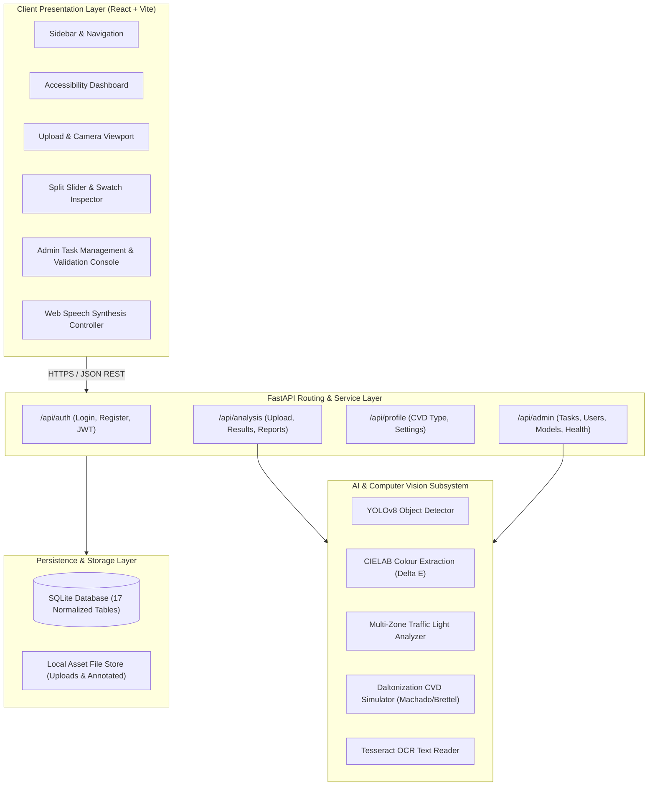
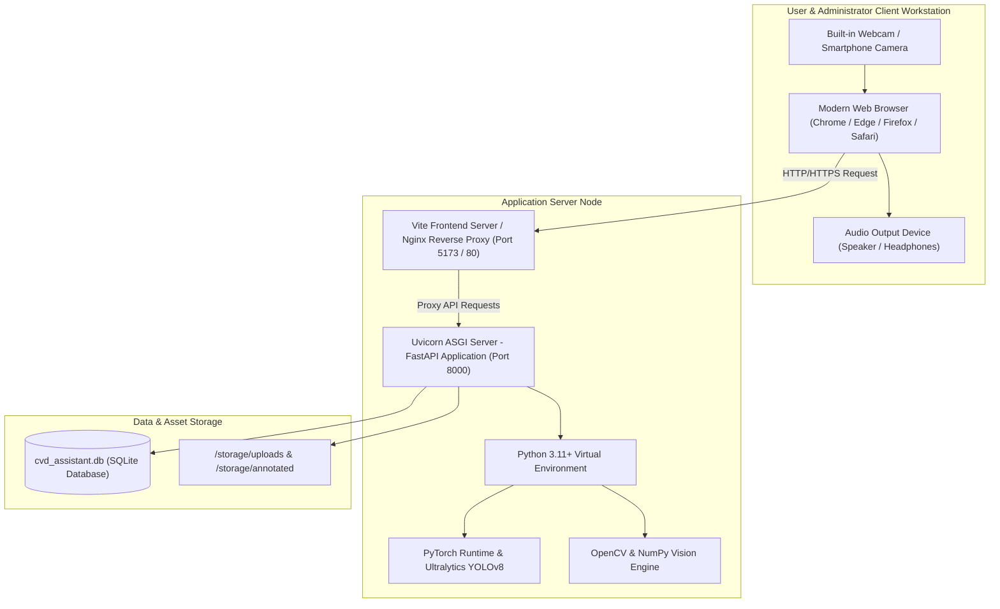
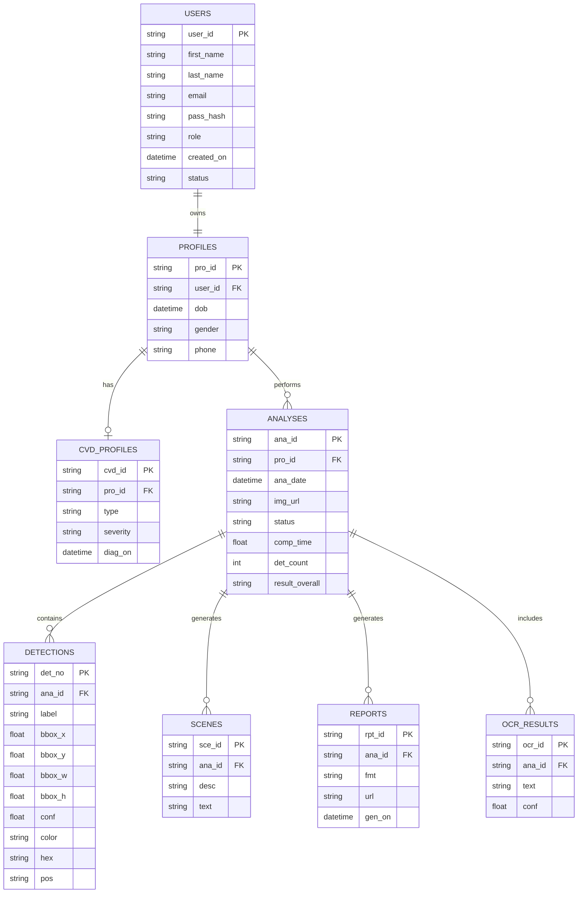
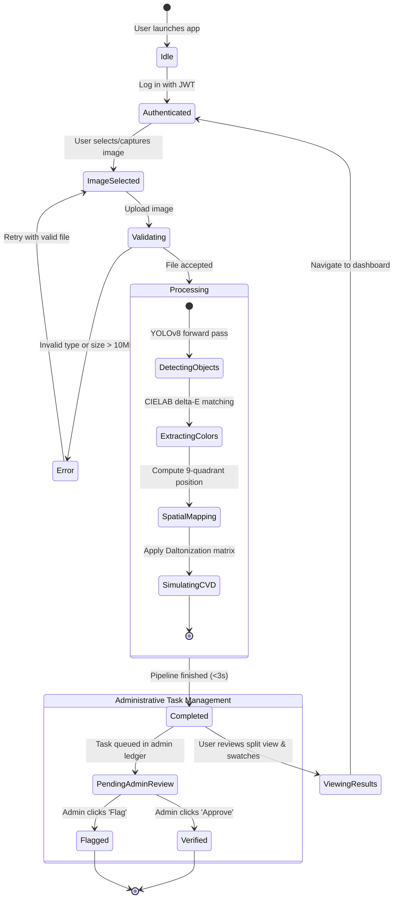
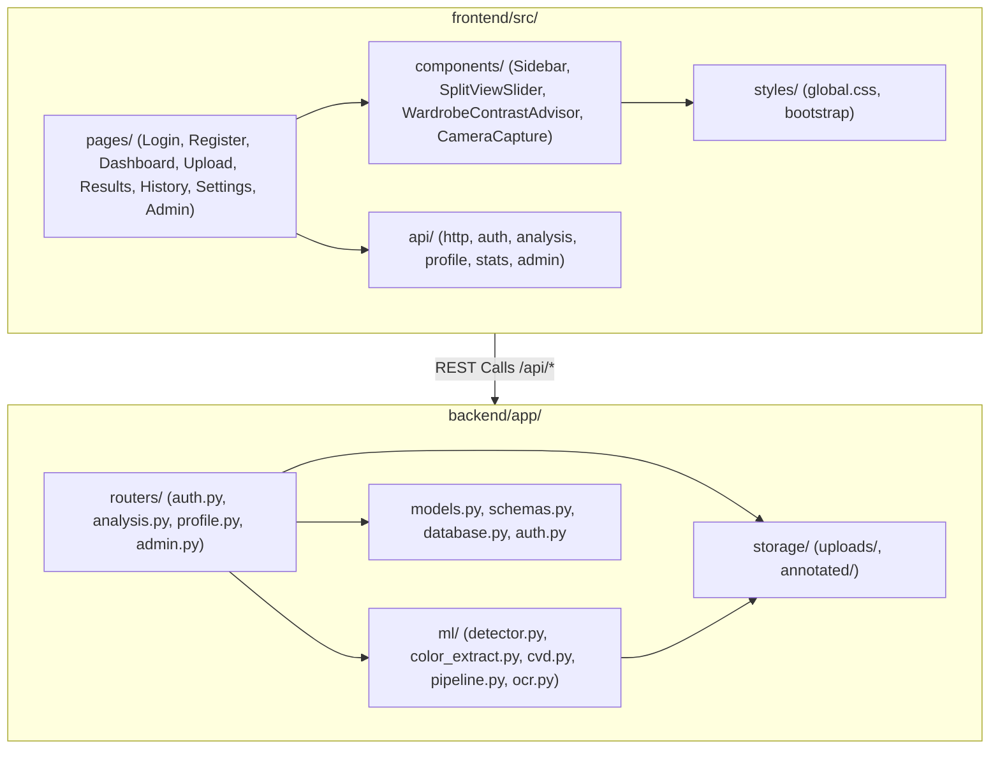

# SPECTRUM CARE (CHROMA CONTEXT) — COMPLETE UML DIAGRAMS SPECIFICATION

This document provides the complete, updated Unified Modeling Language (UML) specifications reflecting all components implemented in the project, including the **Administrator Task Validation & Management Module**, **YOLOv8 Deep Learning Detector**, **CIELAB Perceptual Colour Engine**, **Daltonized CVD Simulation**, and **Web Speech Voice Assistant**.

---

## 1. Use Case Diagram

### Actors:
- **Registered User (CVD Learner/Individual)**: Registers, uploads/captures images, views spatial contextual results, listens to voice guidance, and manages CVD profiles.
- **Administrator**: Validates analysis tasks, reviews detection accuracy, manages user account access, and configures AI model detection thresholds.

---

## 2. Activity Diagram (End-to-End Task & Analysis Workflow)

---

## 3. Class Diagram

---

## 4. Sequence Diagram (User Analysis & Admin Validation)

---

## 5. Component Diagram

---

## 6. Deployment Diagram

---

## 7. Entity-Relationship (ER) Diagram

---

## 8. State Machine Diagram (Analysis Task Lifecycle)

---

## 9. Package Diagram

